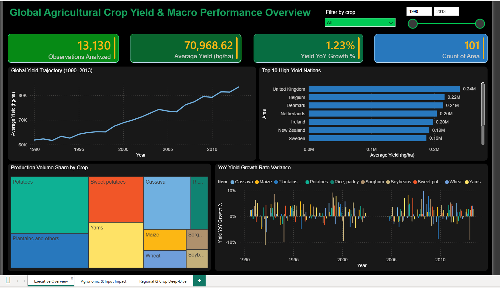
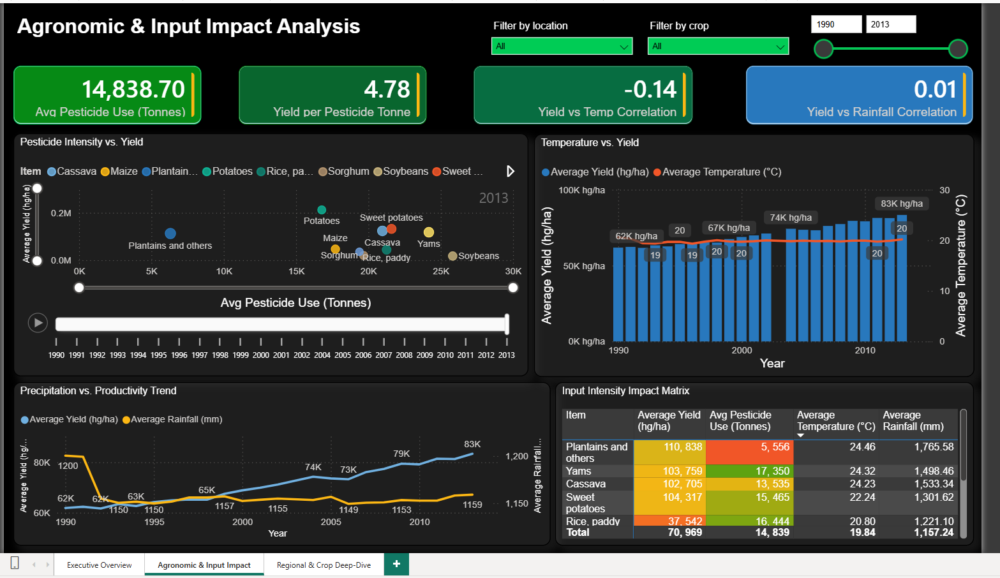
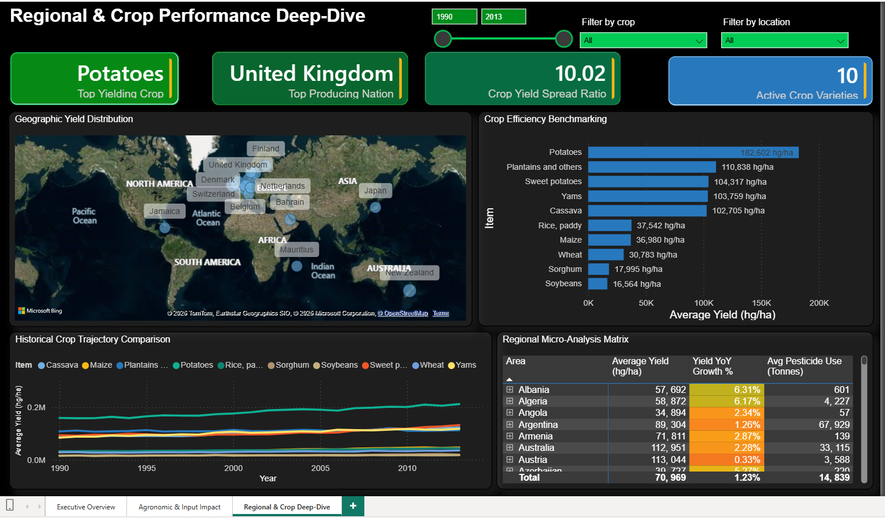

# Global Crop Yield & Agricultural Input Analytics

A Power BI investigation into crop yield patterns across 101 countries and 10 crops (1990–2013), examining how yield density relates to pesticide use, rainfall, and temperature.


---

## At a Glance

| | |
| --- | --- |
| **Scope** | 101 countries · 10 crops · 1990–2013 · 13,130 country-crop-year records |
| **Type** | Descriptive & diagnostic analytics (no predictive model) |
| **Tools** | Power Query (M), Power BI data modeling, DAX |
| **Pages** | Executive Overview · Agronomic & Input Impact · Regional & Crop Deep-Dive |

## Screenshots

The project includes the final approved dashboard screenshots in `images/`:

- `01-executive-overview.png`
- `02-agronomic-input-impact.png`
- `03-regional-crop-deep-dive.png`

| Executive Overview | Agronomic & Input Impact |
| --- | --- |
|  |  |



See [`images/README.md`](images/README.md) for the approved capture list and display guidance.

## What This Project Answers

- How has global crop yield density changed between 1990 and 2013?
- Which countries and crops achieve the highest yield density, and how much do they differ?
- How strongly are yield, temperature, rainfall, and pesticide use associated with each other?
- Where is a country or crop under- or over-performing relative to its peers?

This is diagnostic and descriptive work — it explains what the historical data shows and how strongly factors are associated. It does not forecast future yields; no regression, classification, or train/test methodology is used anywhere in the model.

## Key Findings

| Metric | Value |
| --- | --- |
| Average yield (pooled, all crops) | 70,969 hg/ha |
| Year-over-year yield growth | 1.23% average, 1990–2013 |
| Top-yielding crop | Potatoes (182,602 hg/ha) |
| Top-producing nation (by yield) | United Kingdom |
| Yield vs. temperature correlation | -0.14 (weak) |
| Yield vs. rainfall correlation | 0.01 (negligible) |
| Average pesticide use | 14,838.70 tonnes per country-year |

Full findings and interpretation: [`documentation/EXECUTIVE_BRIEFING.pdf`](documentation/EXECUTIVE_BRIEFING.pdf).

**A methodology note worth surfacing:** yield density (`hg/ha`) is an intensive quantity, and pesticide/rainfall figures are recorded at country-year grain rather than per-crop — both facts shape how several measures in this model are deliberately built (see [`documentation/DATA_DICTIONARY.md`](documentation/DATA_DICTIONARY.md#7-interpreting-the-model--notes-for-any-user)). Getting this right matters: a naive `SUM` over either of these fields produces numbers that are off by one to two orders of magnitude.

## Data Model

Star schema — one fact table (`yield_df`, 13,130 rows) and three dimensions (`Dim_Crop`, `Dim_Location`, `Dim_Date`), with 15 DAX measures spanning aggregation, ratio, gap-aware time intelligence, and Pearson correlation. Full detail: [`documentation/DATA_DICTIONARY.md`](documentation/DATA_DICTIONARY.md).

## Public Data Status

The raw underlying files are excluded from this public repository because the exact redistribution licence for the published Kaggle source could not be independently confirmed. The public release therefore keeps the analysis, documentation, screenshots, and derived model artifacts while omitting the raw dataset files and the downloadable `.pbix` containing imported source copies.

## Repository Structure

```
├── dashboard/
│   └── README.md            (public workbook removed; repository retains methodology and screenshots)
├── data/
│   └── README.md            (states raw source files are excluded from this public repo)
├── documentation/
│   ├── DATA_DICTIONARY.md
│   ├── SYSTEM_ARCHITECTURE.md
│   ├── EXECUTIVE_BRIEFING.pdf
│   ├── USER_MANUAL.md
│   └── docx/                 (Word originals of all four documents)
├── images/
│   └── README.md
└── README.md
```

## Documentation

| Document | Purpose |
| --- | --- |
| [Data Dictionary & Field Catalog](documentation/DATA_DICTIONARY.md) | Every table, column, relationship, and DAX measure |
| [System Architecture](documentation/SYSTEM_ARCHITECTURE.md) | Data flow, data preparation, and technical notes |
| [Executive Briefing](documentation/EXECUTIVE_BRIEFING.pdf) | Headline findings, business-facing summary |
| [User Manual](documentation/USER_MANUAL.md) | How to navigate and correctly read the dashboard |

## Running This Locally

This public repository intentionally omits the raw dataset and the packaged `.pbix` file. To reproduce the analysis locally, you would need a private copy of the original source data and a local Power BI build that is not published here.

1. Use the project documentation and screenshots in this repository to review the analytical structure.
2. Keep the raw source data in a private, non-public working copy if you are reproducing the full workbook locally.
3. Do not assume that the published repository contains a redistributable data copy or a downloadable `.pbix`.

## Skills Demonstrated

Data modeling (star schema design) · Power Query (M) transformation and data consolidation · DAX (aggregation, ratio, gap-aware time intelligence, manually-derived Pearson correlation) · data quality auditing (grain analysis, intensive-vs-additive quantity handling) · dashboard UX across a three-page narrative · technical and business documentation.

## License

The public project files in this repository are shared for portfolio presentation and methodology review. The underlying source dataset is not redistributed here because its licence could not be independently confirmed, and the Kaggle-originated source is therefore excluded from the public repository.

## Author

**John O. Ezekiel** — Agricultural & Environmental Engineer | Data Analyst
[LinkedIn](https://www.linkedin.com/in/johnoezekiel) · [GitHub](https://github.com/johnoe0710) · johnoe.office@gmail.com
